<div align="center">

<picture>
  <source media="(prefers-color-scheme: dark)" srcset=".github/assets/readme/hero-dark.webp">
  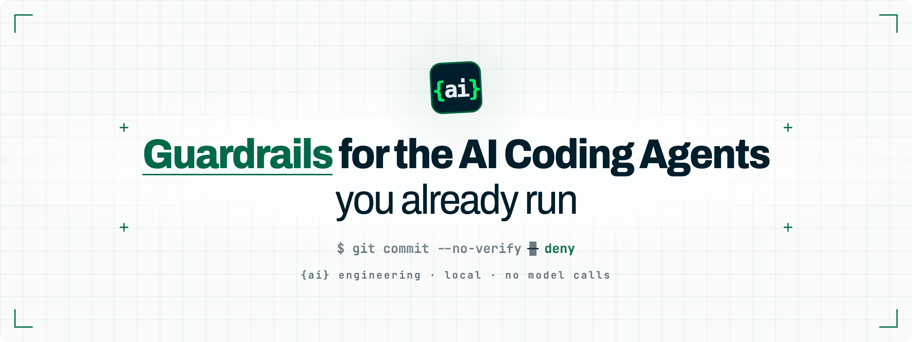
</picture>

When the agent reaches for `git commit --no-verify` or an `eslint-disable` line to turn a red check green,<br/>
ai-eng refuses the call before it runs and tells the agent why.<br/>
Every refusal is saved in your repository as a plain file.

<a href="#get-it"><picture><source media="(prefers-color-scheme: dark)" srcset=".github/assets/readme/button-start-dark.webp"></picture></a>&nbsp;&nbsp;<a href="#where-it-stops"><picture><source media="(prefers-color-scheme: dark)" srcset=".github/assets/readme/button-stops-dark.webp"></picture></a>

<sub>Bun 1.4.4+ · macOS · Linux · Windows · Apache-2.0 · Runs on your machine and calls no model · 7 of 10 agent hosts enforced and verified on 2026-11-23</sub>

<p>
  <a href="https://github.com/arcasilesgroup/ai-engineering/releases/latest"></a>
  <a href="https://www.npmjs.com/package/ai-engineering"></a>
  <a href="https://github.com/arcasilesgroup/ai-engineering/actions/workflows/check.yml"></a>
  <a href="https://sonarcloud.io/component_measures?id=arcasilesgroup_ai-engineering&amp;metric=coverage"></a>
  <a href="LICENSE"></a>
</p>

<sub><a href="#guards">Guards</a> · <a href="#receipts">Receipts</a> · <a href="#fail-closed">Fail closed</a> · <a href="#your-repo">Your repo</a> · <a href="#measured">Measured</a> · <a href="#where-it-stops">Where it stops</a> · <a href="#under-the-hood">Under the hood</a> · <a href="#release">Release</a> · <a href="#skills">Skills</a> · <a href="#answers">Answers</a> · <a href="#get-it">Get it</a> · <a href="#build-with-us">Build with us</a></sub>

</div>

<a name="guards"></a>
<h2 align="center"><a href="#guards"><picture><source media="(prefers-color-scheme: dark)" srcset=".github/assets/readme/heading-guards-dark.webp"></picture></a></h2>

<p align="center"><code>--no-verify</code> is only one way to skip a hook. <code>git commit -n</code> and <code>HUSKY=0</code> are refused before git starts too, and the agent is told why.</p>

<p align="center">
  <a href="src/guards/no-verify.ts">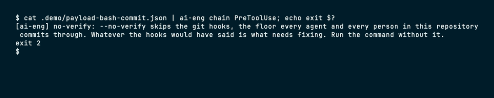</a>
  <br/><sub>The agent tried <code>git commit --no-verify</code>. The chain refused it before git ran, and said why.</sub>
</p>

<p align="center">
  <a href="src/guards/no-verify.ts">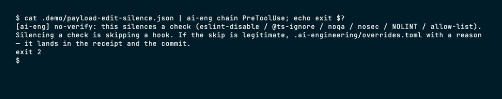</a>
  <br/><sub>The agent tried to silence a linter in an edit. Refused, with the one legitimate way around it.</sub>
</p>

<p align="center">
  <a href="src/guards/wrap.ts">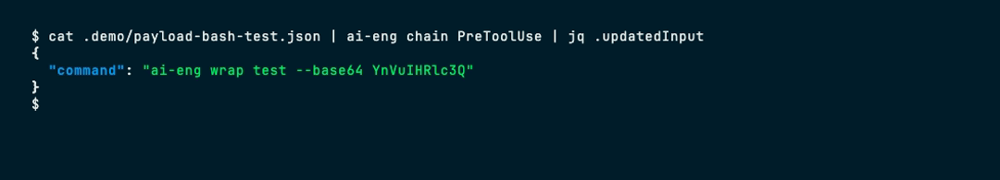</a>
  <br/><sub>A test run became <code>ai-eng wrap test</code>, which prints only the failures. Not every answer is a refusal.</sub>
</p>

<p align="center">
  <picture>
    <source media="(prefers-color-scheme: dark)" srcset=".github/assets/readme/figure-1-tool-call-dark.webp">
    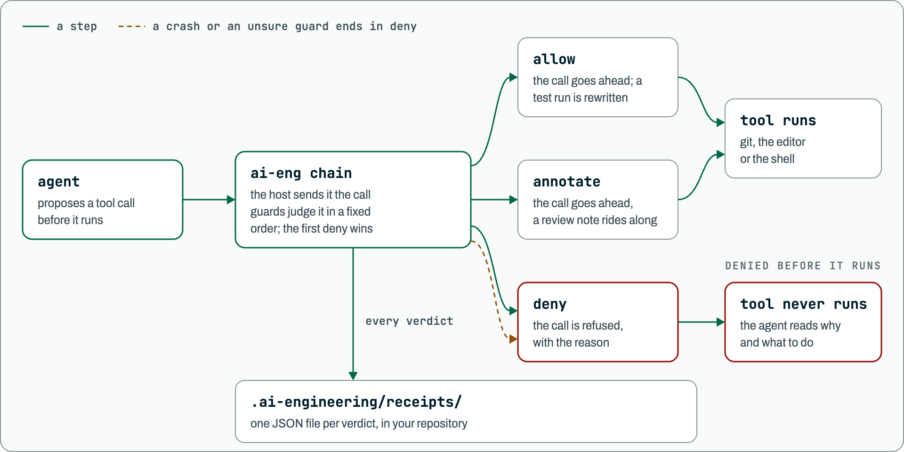
  </picture>
  <br/><sub><b>Figure 1.</b> One tool call. The refusal arrives before the tool runs, so the call never starts. The dashed line is a check, not a step: a guard that crashes or cannot decide also ends in a refusal.</sub>
</p>

<details>
<summary>Text version of figure 1</summary>

1. The agent proposes a tool call: a command, an edit or a read.
2. The host sends the call to `ai-eng chain`, which runs the guards in a fixed order. The first refusal wins.
3. The verdict is allow (a recognised test command is rewritten to show only failures), annotate (the call goes ahead with a review note) or deny (the call is refused, with the reason).
4. On allow or annotate the tool runs. On deny it never runs, and the agent is told why and what to do instead.
5. A guard that crashes or cannot decide ends in a refusal.
6. Every verdict writes one JSON file to `.ai-engineering/receipts/`.

</details>

<table align="center">
  <tr>
    <td><picture><source media="(prefers-color-scheme: dark)" srcset=".github/assets/readme/card-blocks-dark.webp">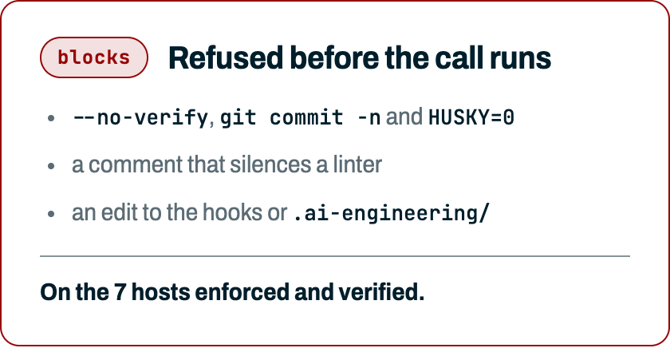</picture></td>
    <td><picture><source media="(prefers-color-scheme: dark)" srcset=".github/assets/readme/card-informs-dark.webp">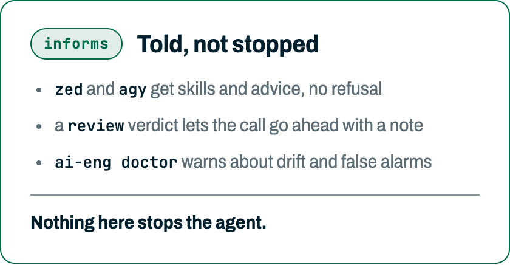</picture></td>
  </tr>
</table>

Seven guards read each governed tool call and answer before the tool runs. The cards split what stops the agent from what only tells it. The hosts where a refusal stands are in [Where the agent still can](#where-it-stops).

<details>
<summary>The nine checks, in order</summary>

Each guard runs only for the tools it governs, in this order, and the first refusal wins:

| Order | Guard | Refuses |
|---|---|---|
| 1 | `self-protect` | writes to anything that governs the agent: `.ai-engineering/` (except the milestone files a session owns), the agent settings, the git hooks, the installed skills |
| 2 | `no-verify` | anything that skips the git hooks: `--no-verify`, `git commit -n`, `HUSKY=0`, deleting the hooks folder, repointing `core.hooksPath`. And every comment that silences a linter or a type checker: ESLint, TypeScript, Ruff and Flake8, Bandit, clang-tidy |
| 3 | `no-stash` | creating a stash, which takes work off its branch; `list`, `show`, `apply`, `pop` and `branch` still work |
| 4 | `policy` | commands outside the allowed scope (see [configuration](docs/configuration.md)) |
| 5 | `injection` | reading a file, or acting on a fetched page, whose text carries instructions to the model. The text is data, never an order |
| 6 | `loop` | the same call repeated, or the same failure retried with small changes |
| 7 | `checkpoint` | phase and gate writes that break the active workflow checkpoint. It is the workflow gate, not a protection guard |
| 8 | `lease` | a write in a folder another session wrote in during the last 15 minutes. The second session goes to a worktree; `ai-eng work release` frees the folder |
| 9 | `wrap` | nothing. It rewrites a recognized test command to `ai-eng wrap test -- <command>`, which prints only the failures and a summary |

`spoken-secret` checks each prompt you submit, on agents with a prompt hook. It refuses a prompt that seems to contain a credential, and it never prints the value it found.

</details>

<a name="receipts"></a>
<h2 align="center"><a href="#receipts"><picture><source media="(prefers-color-scheme: dark)" srcset=".github/assets/readme/heading-receipts-dark.webp"></picture></a></h2>

<p align="center">Git keeps no record of a skipped hook. Every answer here lands in <code>.ai-engineering/receipts/</code> as a plain JSON file you can read and grep.</p>

<p align="center">
  <a href="src/receipts.ts">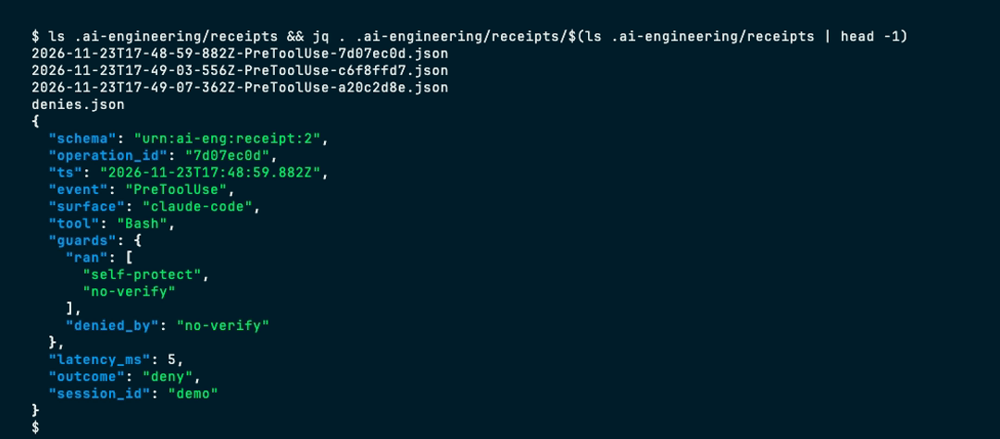</a>
  <br/><sub>Three verdicts, three files in your repository. A receipt is a file; anyone who can write to the folder can write one, so treat it as a log, not as proof.</sub>
</p>

<a name="fail-closed"></a>
<h2 align="center"><a href="#fail-closed"><picture><source media="(prefers-color-scheme: dark)" srcset=".github/assets/readme/heading-fail-closed-dark.webp"></picture></a></h2>

<p align="center">A check that crashes or cannot decide refuses the call. Copilot and Codex are the exceptions, and the section names exactly when.</p>

<table align="center">
  <tr>
    <td><b>Crash means refuse.</b> A guard that crashes refuses the call.</td>
    <td><b>Unsure means refuse.</b> A guard that cannot decide refuses it too.</td>
  </tr>
  <tr>
    <td><b>One written bypass.</b> An entry in <code>.ai-engineering/overrides.toml</code> needs a <code>reason</code> and an <code>until</code> date. Each override lands in the receipt and in the commit.</td>
    <td><b>Expiry turns it back on.</b> <code>ai-eng doctor</code> lists every active entry with its time left. When the date passes, the check is on again.</td>
  </tr>
</table>

The exceptions are real. The Copilot adapter (CLI and VS Code) fails open on a timeout and when `ai-eng` is not on `PATH`, and Codex fails open on a hook error. Both are in [Where the agent still can](#where-it-stops), next to the dated host matrix.

<a name="your-repo"></a>
<h2 align="center"><a href="#your-repo"><picture><source media="(prefers-color-scheme: dark)" srcset=".github/assets/readme/heading-your-repo-dark.webp"></picture></a></h2>

<p align="center">They are files in git, reviewed like code. The agent's edits to them are refused, and turning a check off takes a dated entry that expires.</p>

- **Versioned files.** `AGENTS.md`, `DECISIONS.md`, `.ai-engineering/config.toml` and the git hooks sit in your repository, plus `~/.ai-engineering/` on your machine.
- **Self-protected.** `self-protect` is the first guard in the order. The agent cannot write to the files that govern it; a person changes them in a reviewed diff.
- **Local only.** 0 hosted services, 0 model calls. No prompt and no source leaves the machine.
- **One optional network read.** Commands you type ask the npm registry for a newer version at most every 24 hours. Set `AI_ENG_NO_UPDATE_NOTICES=1` and it never does. Offline, the check stays silent.

<a name="measured"></a>
<h2 align="center"><a href="#measured"><picture><source media="(prefers-color-scheme: dark)" srcset=".github/assets/readme/heading-measured-dark.webp"></picture></a></h2>

<p align="center">Under 3 ms per tool call at p95 on our Mac, and 7 of 10 hosts enforced and verified. Every figure names its command or the dated matrix.</p>

<table align="center">
  <tr>
    <td align="center"><h1>2,600+</h1><b>tests in the suite</b><br/><sub>2,695 passing, 1 skipped, 0 failing on 2026-11-23 · <code>bun test</code></sub></td>
    <td align="center"><h1>12</h1><b>false alarms we fixed, each paired with the attack it looks like</b><br/><sub>each one now passes, each paired attack is still refused · <code>bun test tests/friction-corpus.spec.ts</code></sub></td>
    <td align="center"><h1>under 3 ms</h1><b>added to a tool call, 95th percentile</b><br/><sub>2.56, 2.64 and 2.72 ms in three runs of 100 calls · <code>bun run bench</code></sub></td>
    <td align="center"><h1>7 of 10</h1><b>agent hosts enforced and verified</b><br/><sub>1 enforced but unverified, 2 advisory only · <a href="docs/surface-capability-matrix.md">capability matrix</a></sub></td>
  </tr>
</table>

<p align="center"><sub>Measured by the maintainers on one Mac (arm64) on 2026-11-23, on top of commit <code>efc35b38</code>. Test results on our machine, not a promise about yours.</sub></p>

Want the figure for your repo? `ai-eng doctor` counts refusals per 1,000 real tool calls from your own receipts, and warns above 50 or on any call you mark as a false alarm. We publish the method and the test corpus. We do not publish anyone's receipts, our own included.

<table align="center">
  <tr>
    <td><b>Every refusal has a twin.</b> Each false alarm we fixed sits next to the real attack it resembles, and both are tested.</td>
    <td><b>The gates are tested too.</b> Each one runs against fixtures that break exactly one rule.</td>
  </tr>
  <tr>
    <td><b>Mutants on the checks.</b> Mutation testing runs on the checks, and the build fails below a score of 58 (<code>stryker.conf.mjs</code>).</td>
    <td><b>Six adversarial suites.</b> Written to break the chain, in <a href="tests/adversarial"><code>tests/adversarial/</code></a>.</td>
  </tr>
</table>

<a name="where-it-stops"></a>
<h2 align="center"><a href="#where-it-stops"><picture><source media="(prefers-color-scheme: dark)" srcset=".github/assets/readme/heading-where-it-stops-dark.webp"></picture></a></h2>

<p align="center">ai-eng is not a sandbox. This section lists every way past it that we know of, beside the dated host matrix.</p>

<p align="center">
  <picture>
    <source media="(prefers-color-scheme: dark)" srcset=".github/assets/readme/figure-2-layers-dark.webp">
    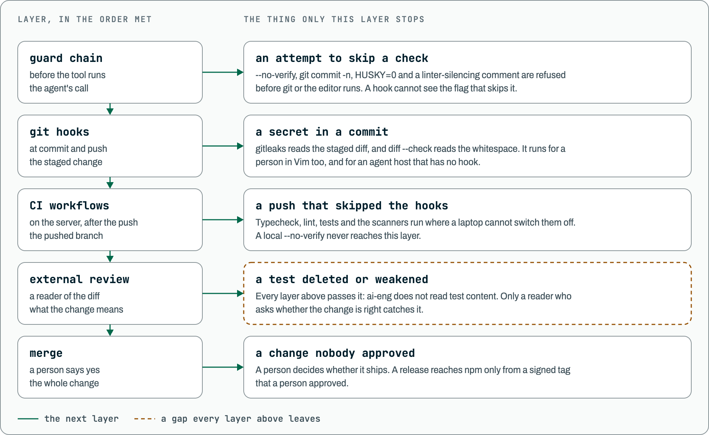
  </picture>
  <br/><sub><b>Figure 2.</b> The layers, in the order a change meets them. The dashed row is a gap: no layer above external review reads what a test checks.</sub>
</p>

<details>
<summary>Text version of figure 2</summary>

1. Guard chain, before the tool runs: it alone stops an attempt to skip a check, because a hook cannot see the flag that skips it.
2. Git hooks, at commit and push: they alone read the staged diff for a secret, and they run for a person as well as an agent.
3. CI workflows, on the server after the push: they alone stop a push that skipped the local hooks, because a laptop cannot switch them off.
4. External review: it alone catches a test that was deleted or weakened. ai-eng does not read test content, so every layer above passes it.
5. Merge: a person decides whether the change ships. A release reaches npm only from a signed tag that a person approved.

</details>

<p align="center">
  <picture>
    <source media="(prefers-color-scheme: dark)" srcset=".github/assets/readme/figure-3-surfaces-dark.webp">
    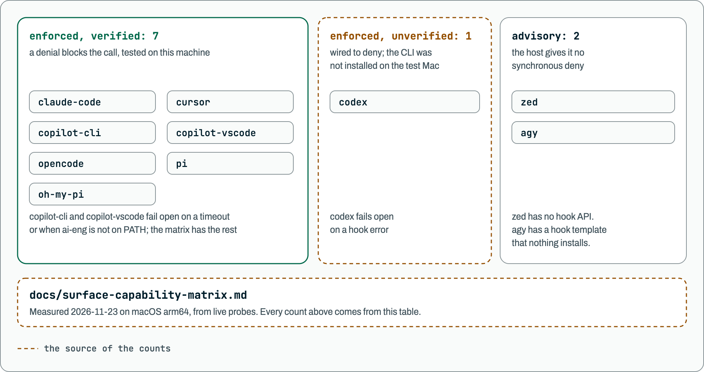
  </picture>
  <br/><sub><b>Figure 3.</b> Which hosts are enforced, which advise, which are unverified. Counts come from the capability matrix, measured 2026-11-23. The dashed box names the source.</sub>
</p>

<details>
<summary>Text version of figure 3</summary>

1. Enforced and verified, 7: `claude-code`, `cursor`, `copilot-cli`, `copilot-vscode`, `opencode`, `pi` and `oh-my-pi`. A denial blocks the call, tested on the measuring machine. The two Copilot hosts fail open on a timeout or when `ai-eng` is not on `PATH`.
2. Enforced but unverified, 1: `codex`. It is wired to deny, but the CLI was not installed on the measuring machine. It fails open on a hook error.
3. Advisory, 2: `zed` and `agy`. `zed` has no hook API; the `agy` hook file is a template that nothing installs. They offer skills and advice, never a refusal.
4. The source of every count is `docs/surface-capability-matrix.md`, measured 2026-11-23 on macOS arm64.

</details>

The guards stop an agent's mistakes. They are not a sandbox.

The Copilot adapter (CLI and VS Code) shares one hook runner and one hook file set for both hosts. Its `preToolUse` command hook **fails closed** on a crash or non-zero exit, but **fails open** when `ai-eng` is not on `PATH` (the template exits 0 on purpose, so a machine without it is not locked out) and on a timeout. The prompt hook is advisory on Copilot: `userPromptSubmitted` command output is ignored.

The Antigravity CLI (agy) is declared and **advisory**, and it cannot be enabled: `ai-eng init --surface agy` and `ai-eng config --add agy` are refused, because no hook of ours judges an agy call yet. Only a hand-edited `[surfaces] enabled = ["agy"]` followed by `ai-eng update` writes its hook file (`~/.gemini/config/hooks.json`), and that file fails soft rather than risk a lockout, because agy denies on any non-zero exit. What is measured, what is unverified (the Windows form has never been run) and what would make the surface enforceable are in the [capability matrix](docs/surface-capability-matrix.md).

Command guards read the visible command text. They do not sandbox opaque programs or scripts prepared in earlier calls: a script written in one call and run in a later call does whatever it contains.

For untrusted code, use OS-level isolation: a container, a VM or an OS sandbox.

Some limits are not on the host list at all. ai-eng does not read test content, so an agent that deletes a failing test or weakens an assertion still gets a green build. [Figure 2](#where-it-stops) shows which layer is meant to catch that.

<a name="under-the-hood"></a>
<h2 align="center"><a href="#under-the-hood"><picture><source media="(prefers-color-scheme: dark)" srcset=".github/assets/readme/heading-under-the-hood-dark.webp"></picture></a></h2>

<p align="center">Eight agent hosts call the same local command before a tool runs; seven of them we have verified. It needs no server and calls no model.</p>

<p align="center">
  <picture>
    <source media="(prefers-color-scheme: dark)" srcset=".github/assets/readme/figure-4-single-parse-dark.webp">
    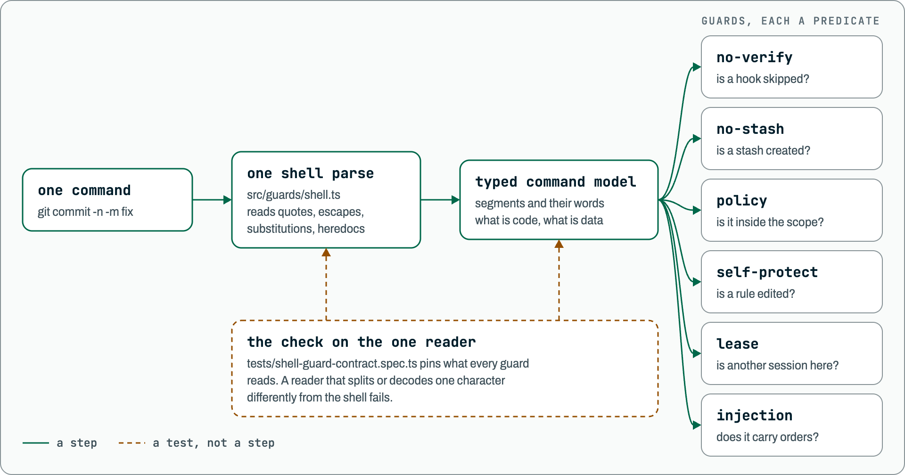
  </picture>
  <br/><sub><b>Figure 4.</b> One parse, many guards. Each guard asks a question of the same typed model, so none reads a command differently from the shell. The dashed box is a test, not a step.</sub>
</p>

<details>
<summary>Text version of figure 4</summary>

1. A command arrives as text, for example `git commit -n -m fix`.
2. One reader, `src/guards/shell.ts`, parses it the way the shell will: quotes, escapes, substitutions and heredocs.
3. The result is a typed command model: segments, their words, and which text is code and which is data.
4. Six guards read that model as predicates: `no-verify` asks whether a hook is skipped, `no-stash` whether a stash is created, `policy` whether the call is inside the scope, `self-protect` whether a rule is edited, `lease` whether another session is writing there, and `injection` whether the text carries orders for the model.
5. The check on the reader is `tests/shell-guard-contract.spec.ts`. It pins what every guard reads, so a reader that splits or decodes one character differently from the shell fails.

</details>

- **Policy is code, not a prompt.** The model reads `AGENTS.md` and can choose otherwise. The guards run on every call and cannot be talked out of it.
- **One definition set for every host.** The same guard judges the same call whichever host sent it. [`src/surfaces/surfaces.json`](src/surfaces/surfaces.json) records what each host supports.
- **Answers in the host's own format.** The chain reads the host's payload on stdin and replies in the same dialect.
- **Built with** Bun and TypeScript, with 2 runtime dependencies (`@clack/prompts`, `fast-wrap-ansi`).

The two hosts that never call the command: Zed has no hook API, and the agy hook file is a template nothing installs.

<a name="release"></a>
<h2 align="center"><a href="#release"><picture><source media="(prefers-color-scheme: dark)" srcset=".github/assets/readme/heading-release-dark.webp"></picture></a></h2>

<p align="center">Each ai-eng release reaches npm only from a signed tag a person approved, with its provenance verified first. <code>npm audit signatures</code> checks that provenance on your machine.</p>

1. A signed annotated tag, from an allowed key, on exactly the dispatched commit.
2. Every row of [NOTICE.md](NOTICE.md) marked `verified`.
3. A person approves the run (`environment: release`).
4. A CycloneDX SBOM, and build-provenance attestations verified before publish.
5. `npm publish --provenance` (SLSA v1).

The rules are in [`scripts/release-policy.ts`](scripts/release-policy.ts) and [`.github/workflows/release.yml`](.github/workflows/release.yml). Check a release yourself:

```bash
npm audit signatures
gh attestation verify ai-eng-darwin-arm64 --repo arcasilesgroup/ai-engineering   # a binary from the GitHub release
```

<a name="skills"></a>
<h2 align="center"><a href="#skills"><picture><source media="(prefers-color-scheme: dark)" srcset=".github/assets/readme/heading-skills-dark.webp"></picture></a></h2>

<p align="center">Give <code>ai-orchestrator</code> a feature and it builds it in checkpoints that pass the same checks. It stops for your yes on the plan and on the result.</p>

<p align="center">
  <picture>
    <source media="(prefers-color-scheme: dark)" srcset=".github/assets/skill-chain-dark.svg">
    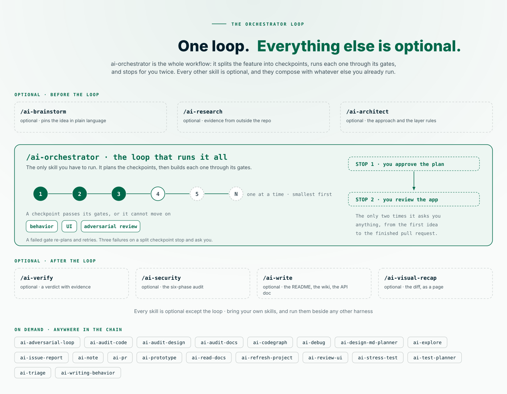
  </picture>
</p>

None of this is required to get the refusals above. The 27 skills, the build loop among them, are in [docs/skills.md](docs/skills.md).

<a name="answers"></a>
<h2 align="center"><a href="#answers"><picture><source media="(prefers-color-scheme: dark)" srcset=".github/assets/readme/heading-answers-dark.webp"></picture></a></h2>

<details>
<summary><b>Can the agent get around it?</b></summary>

Yes, and we list how. It is not a sandbox: command checks read the visible command, so a script written in one call and run in a later call does whatever it contains. Copilot lets a call through on a timeout, and Codex on a hook error. On Zed and Antigravity it can only advise. What it does close are the common forms of skipping a hook (`-n`, `HUSKY=0`, a new `core.hooksPath`) and every edit to its own rules. For untrusted code, use a container or a VM.

</details>

<details>
<summary><b>Can I turn a check off?</b></summary>

Yes, in one place. Add an entry to `.ai-engineering/overrides.toml` with a reason and an end date. The agent cannot write to that file, the commit message must carry the reason, and `ai-eng doctor` shows every active entry with its time left. When the date passes, the check turns itself back on. To remove everything, run `ai-eng uninstall`; it keeps your own files.

</details>

<details>
<summary><b>Why not write the rule in AGENTS.md?</b></summary>

You should, and ai-eng writes one for you. But the model reads AGENTS.md and can choose otherwise, which is how most hook-skipping commits happen. A rule that must never break belongs in code that runs on every call. AGENTS.md keeps the judgement calls, and the checks handle the rules that never change.

</details>

<details>
<summary><b>What does it cost?</b></summary>

No money: it is Apache-2.0. On our Mac it adds under 3 ms to a tool call at the 95th percentile (`bun run bench`). It also costs context. Your agent loads about 3,000 tokens of skill descriptions and about 1,200 for the `AGENTS.md` template, by a bytes-divided-by-four estimate (`bun run tokens`). Those tokens are the real price, so they are measured.

</details>

<details>
<summary><b>Does it phone home?</b></summary>

Once a day at most, and you can stop it. Commands you type ask the npm registry whether a newer version exists, at most every 24 hours. Set `AI_ENG_NO_UPDATE_NOTICES=1` and it never does. It sends no telemetry and calls no model. Your prompts and your source never leave the machine.

</details>

<details>
<summary><b>Which agents does it work with?</b></summary>

Measured on 2026-11-23, it enforces and has verified Claude Code, Cursor, Copilot CLI, Copilot in VS Code, opencode, pi and oh-my-pi. It enforces Codex, but we have not verified Codex on our machine yet. On Zed and Antigravity it is advisory only. The [capability matrix](docs/surface-capability-matrix.md) has the details and the date. `ai-eng doctor` tells you which of your agents are enforced.

</details>

<details>
<summary><b>What happens when it is wrong?</b></summary>

When it refuses something harmless, it tells you which check fired and why, so you can add a dated override. `ai-eng doctor` warns if refusals climb above 50 per 1,000 calls. Every false alarm we have fixed is kept in a test, paired with the attack it looks like. When it misses something, report it: on an enforced host, a way past a check that our list does not already name is a security bug.

</details>

<a name="get-it"></a>
<h2 align="center"><a href="#get-it"><picture><source media="(prefers-color-scheme: dark)" srcset=".github/assets/readme/heading-get-it-dark.webp"></picture></a></h2>

<p align="center">Install the CLI and run <code>ai-eng init</code> in a repository. Then <code>ai-eng doctor</code> sends one real attack payload and shows you the refusal.</p>

Install [Bun](https://bun.com) (>= 1.4.4) once. On macOS and Linux: `curl -fsSL https://bun.sh/install | bash`. Then the CLI, then govern a repository:

```bash
bun add -g ai-engineering@latest    # or: npm install -g ai-engineering@latest
ai-eng init
ai-eng doctor
```

`ai-eng init` asks which agents to govern, installs the skills on your machine, and writes the contract into the repository you are in. Run it again at any time; it converges. Hooks do not run in an untrusted folder, so trust the folder in your agent once. That is the one step `ai-eng` cannot do for you.

<p align="center">
  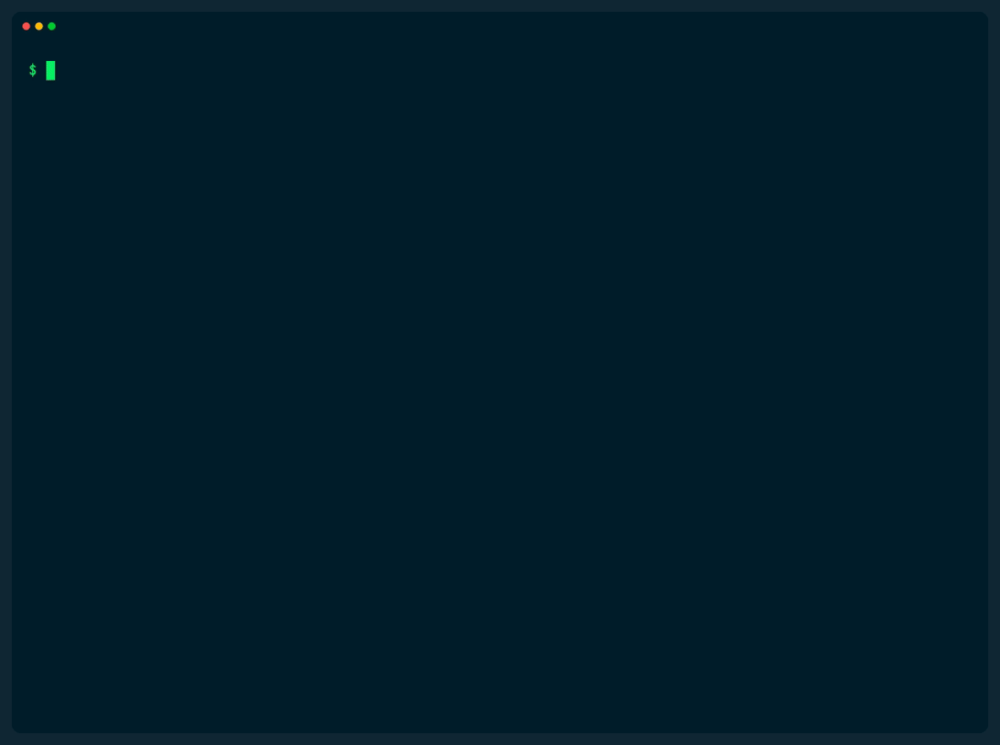
  <br/><sub>a real session, sped up: <code>ai-eng init</code>, then <code>ai-eng doctor</code></sub>
</p>

More: [install edge cases](docs/install.md) (from source, no administrator rights, Windows) · [CLI](docs/cli.md) · [lanes](docs/lanes.md) · [configuration](docs/configuration.md) · [troubleshooting](docs/troubleshooting.md) · [skills](docs/skills.md).

<a name="build-with-us"></a>
<h2 align="center"><a href="#build-with-us"><picture><source media="(prefers-color-scheme: dark)" srcset=".github/assets/readme/heading-build-with-us-dark.webp"></picture></a></h2>

<p align="center">Report it through <a href="SECURITY.md">SECURITY.md</a>. On an enforced host, any way past a check that our list does not already name is a security bug.</p>

Read [CONTRIBUTING.md](CONTRIBUTING.md) and the [Code of Conduct](CODE_OF_CONDUCT.md) before you open a pull request. To work on ai-eng itself:

```bash
bun install
bun run build                  # compile the binary, skills, agents and templates inside
bun test                       # unit, adversarial, gate and architecture tests
bun run lint && bun run typecheck
bun scripts/readme-diagrams.ts # regenerate the two skill and guard-flow SVGs
bun scripts/readme-assets.ts   # re-render the README's headings, buttons, cards, hero and figures
```

The terminal stills are recorded with [VHS](https://github.com/charmbracelet/vhs) from real hook payloads: see `.github/assets/tapes/stills.tape`. Versions come from [changesets](.changeset/README.md); [docs/history](docs/history/recap.html) holds the early design record, which is history.

<p align="center"><sub>Apache-2.0 © <a href="https://github.com/arcasilesgroup">Arcasiles Group</a> · <a href="LICENSE">LICENSE</a> · <a href="NOTICE.md">NOTICE</a> · <a href="THIRD-PARTY-NOTICES.md">THIRD-PARTY-NOTICES</a> · <a href="https://ai-engineering.arcasiles.com">website</a></sub></p>
