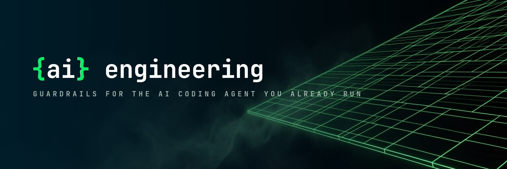
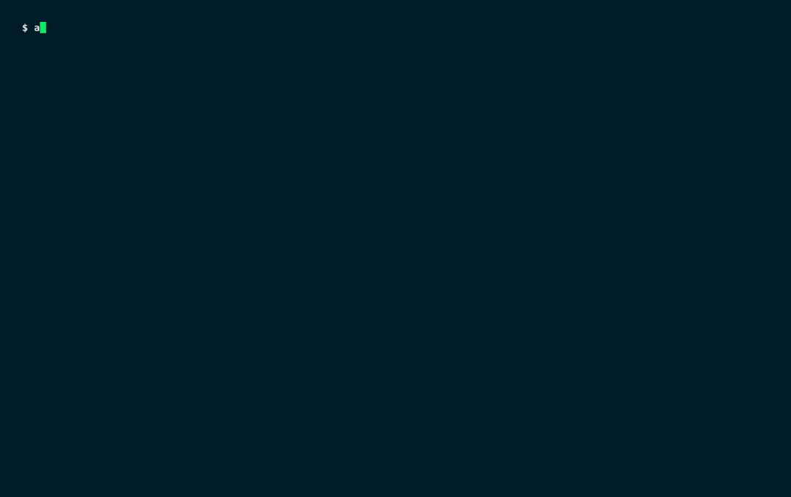
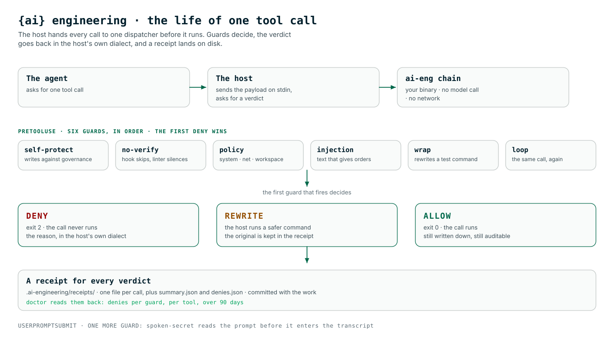
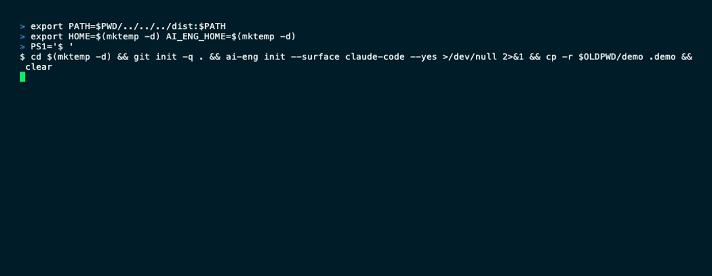
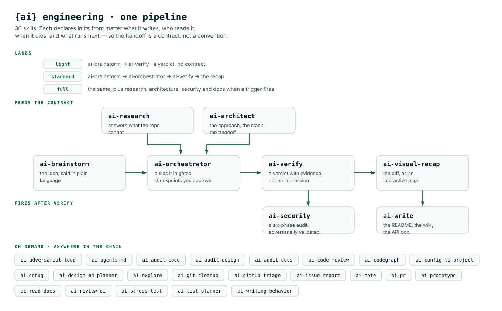
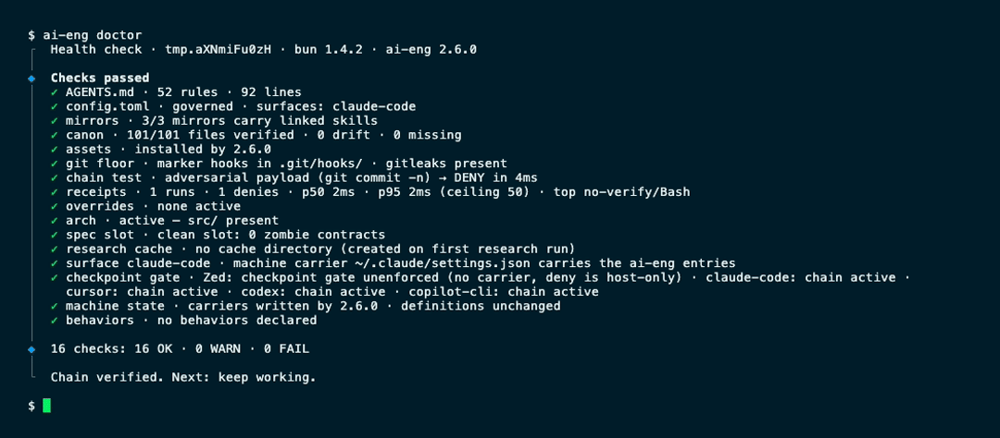

<div align="center">



**Guardrails for AI coding agents: install a contract, deny destructive calls, prove every run.**

<p>A contract the agent cannot execute before you approve it.<br/>
Guards that say <strong>no</strong> before the tool call runs.<br/>
A receipt for every verdict, on disk, in git.</p>

<p>
  <a href="https://www.npmjs.com/package/ai-engineering"><picture>
    <source media="(prefers-color-scheme: dark)" srcset="https://shieldcn.dev/npm/ai-engineering.svg?variant=secondary&amp;font=geist-mono&amp;size=sm&amp;mode=dark">
    
  </picture></a>
  <a href="https://github.com/arcasilesgroup/ai-engineering/actions/workflows/check.yml"><picture>
    <source media="(prefers-color-scheme: dark)" srcset="https://shieldcn.dev/github/ci/arcasilesgroup/ai-engineering.svg?workflow=check.yml&amp;branch=main&amp;variant=secondary&amp;font=geist-mono&amp;size=sm&amp;mode=dark">
    
  </picture></a>
  <a href="https://sonarcloud.io/project/overview?id=arcasilesgroup_ai-engineering"><picture>
    <source media="(prefers-color-scheme: dark)" srcset="https://shieldcn.dev/sonar/quality-gate/arcasilesgroup_ai-engineering.svg?variant=secondary&amp;font=geist-mono&amp;size=sm&amp;mode=dark">
    
  </picture></a>
  <a href="https://sonarcloud.io/component_measures?id=arcasilesgroup_ai-engineering&amp;metric=coverage"><picture>
    <source media="(prefers-color-scheme: dark)" srcset="https://shieldcn.dev/sonar/coverage/arcasilesgroup_ai-engineering.svg?variant=secondary&amp;font=geist-mono&amp;size=sm&amp;mode=dark">
    
  </picture></a>
  <a href="https://snyk.io/test/github/arcasilesgroup/ai-engineering"><picture>
    <source media="(prefers-color-scheme: dark)" srcset="https://shieldcn.dev/badge/security-monitored.svg?logo=snyk&amp;variant=secondary&amp;font=geist-mono&amp;size=sm&amp;mode=dark">
    
  </picture></a>
</p>

<p>
  <a href="https://ai-engineering.arcasiles.com"><picture>
    <source media="(prefers-color-scheme: dark)" srcset="https://shieldcn.dev/badge/website-ai--engineering.arcasiles.com.svg?variant=secondary&amp;font=geist-mono&amp;size=sm&amp;mode=dark">
    
  </picture></a>
  <a href="https://github.com/arcasilesgroup/ai-engineering/releases"><picture>
    <source media="(prefers-color-scheme: dark)" srcset="https://shieldcn.dev/github/release/arcasilesgroup/ai-engineering.svg?variant=secondary&amp;font=geist-mono&amp;size=sm&amp;mode=dark">
    
  </picture></a>
  <a href="LICENSE"><picture>
    <source media="(prefers-color-scheme: dark)" srcset="https://shieldcn.dev/github/license/arcasilesgroup/ai-engineering.svg?variant=secondary&amp;font=geist-mono&amp;size=sm&amp;mode=dark">
    
  </picture></a>
</p>

| | |
|---|---|
| **5** protection guards | Tool-specific checks; the workflow checkpoint gate is separate |
| **1** prompt guard | `spoken-secret`, on surfaces with a prompt hook |
| **1** output filter | `wrap` reduces test-output context; it is not a protection guard |
| **1** npm package | `ai-engineering`; release binaries are separate assets |
| **0** hosted services | No daemon or hosted control plane |
| **0** model calls | By `ai-eng` itself. Your key, your model |

</div>

## The idea

Your coding agent can already run any command, edit any file and read any page. That is the
job. The problem is that nothing stands between the request and the action: a hook-skipping
commit, a silenced linter, a retry loop that never ends, a file whose text tells the model
what to do. By the time you notice, the damage is in your history.

`ai-eng` runs locally under the agent you already use. Host hooks send governed tool calls
to the CLI, which answers in that host's dialect: **allow**, **deny**, or a rewritten
command. It never calls a model or sends prompts and source to a service. Its optional
package-version notice reads registry metadata; verdict receipts stay in the repository.

## Why this exists

The contract every agent needs already exists in your repo, as rules you wrote for people:
do not skip the hooks, do not silence the linter, do not rewrite the config that governs
you. Agents read these rules and follow them most of the time. A rule that has to be
remembered on every call is a habit, and habits lapse.

This project turns the rules that never change into code that runs on every call, and leaves
the judgment calls where they belong: with you.

## Table of contents

- [The idea](#the-idea)
- [Why this exists](#why-this-exists)
- [Security](#security)
- [Security boundary](#security-boundary)
- [Install](#install)
- [Quick start](#quick-start)
- [How a tool call is decided](#how-a-tool-call-is-decided)
- [What it stops](#what-it-stops)
- [The loop and the skills](#the-loop-and-the-skills)
- [Skills](#skills)
- [Surfaces](#surfaces)
- [CLI](#cli)
- [Where to work](#where-to-work)
- [Configuration](#configuration)
- [Under the hood](#under-the-hood)
- [Troubleshooting](#troubleshooting)
- [Development](#development)
- [Maintainers](#maintainers)
- [Contributors](#contributors)
- [License](#license)

## Security

Security is the product, so it comes early. A guard bypass is critical by definition: see
[SECURITY.md](SECURITY.md) for the reporting path.

- **Fail closed.** A guard that crashes denies. A guard that cannot decide denies.
- **The only bypass is written down.** An entry in `.ai-engineering/overrides.toml` with a
  `reason` and an `until` date. `doctor` reports every active one with the time it has left,
  and an expired entry re-arms the guard.
- **No hosted service or daemon.** State is versioned files in your repo and your home
  directory.
- **One optional outbound metadata read.** `init` and `doctor` check the package registry
  at most once per 24 hours; set `AI_ENG_NO_UPDATE_NOTICES=1` to disable it. Offline
  checks stay silent.

## Security boundary

The guards stop an agent's mistakes. They are not a sandbox, so know where they end:

The Copilot adapter (CLI and VS Code) fails open on purpose when `ai-eng` is not on PATH,
so a machine without it is not locked out; a hook that times out also lets the call proceed.

Command guards read the visible command text. They do not sandbox opaque programs or
scripts prepared in earlier calls: a script written in one call and run in a later call
does whatever it contains.

For untrusted code, use OS-level isolation: a container, a VM or an OS sandbox.

## Install

```bash
bun add -g ai-engineering@latest && ai-eng init    # or: npm install -g ai-engineering@latest
```

`ai-eng` runs its TypeScript source under [Bun](https://bun.com), so install Bun once
(>= 1.4.4). `init` then asks which agents to govern, installs the skill canon on your machine,
and writes the contract into the repository you are standing in. It is idempotent: run it
again whenever you like.

The launcher fails with an honest message if Bun is missing. From source, or with no global
install:

```bash
git clone https://github.com/arcasilesgroup/ai-engineering.git
cd ai-engineering && bun install && bun run build && bun link
```

The npm package ships the CLI launcher, source, skills, agents and templates.
GitHub releases separately ship compiled binaries for eight targets.

## Quick start

<p align="center">
  
  <br/><sub>a real session, sped up: <code>ai-eng init</code>, then <code>ai-eng doctor</code></sub>
</p>

1. **Install the CLI package.** `bun add -g ai-engineering@latest` (or npm).
2. **Govern the repo.** Run `ai-eng init` inside it and pick the surfaces you use. It writes
   `AGENTS.md`, `DECISIONS.md`, `.ai-engineering/config.toml` and the git hooks.
3. **Trust the workspace in your host.** Hooks do not run in an untrusted folder. This is the
   one step `ai-eng` cannot do for you.
4. **Prove the chain answers.** Run `ai-eng doctor`. It fires one real adversarial payload at
   the chain and reports whether the deny came back.
5. **Keep working.** Open your agent and give it a task. Tool calls intercepted by the
   configured surface pass through the chain first.

Optional, and worth it once: open the repo in your agent and run `/ai-config-to-project`. That
skill adapts the rules and the architecture contract to this tree.

## How a tool call is decided

<p align="center">
  <picture>
    <source media="(prefers-color-scheme: dark)" srcset=".github/assets/guard-flow-dark.svg">
    
  </picture>
</p>

The dispatcher reads the host's payload on stdin and answers in the same dialect it was called
with, so one set of definitions serves every surface. A guard runs only for the tools it
governs, in a fixed order, and the first deny wins.

| Order | Guard | Denies |
|---|---|---|
| 1 | `self-protect` | writes against anything that governs the agent: `.ai-engineering/` (except the milestone slots a session owns), the surface settings, the git hooks, the global canon |
| 2 | `no-verify` | `--no-verify`, `git commit -n`, `HUSKY=0`, deleting `.git/hooks/`, repointing `core.hooksPath`, and every linter silence: `eslint-disable`, `@ts-ignore`, `@ts-expect-error`, `@ts-nocheck`, `noqa`, `nosec`, `NOLINTNEXTLINE` |
| 3 | `policy` | commands outside the configured scope. Four octal digits for system, external, network and workspace, each read, write or execute. The default is `4667`: system read only, everything else read and write, workspace execute too |
| 4 | `injection` | reading a file whose text carries an instruction payload, and acting on a fetched page that carries one. The text is treated as data, never as an order |
| 5 | `wrap` | output optimization, not a protection guard. It rewrites recognized test commands so `ai-eng wrap test -- <command>` prints failing blocks and a summary, reducing test-output context |
| 6 | `loop` | the same call repeated, or the same failure retried with the arguments tweaked. Thresholds live in `config.toml` |
| 7 | `checkpoint` | validates workflow phase and gate writes when a checkpoint is active |

Separately, `spoken-secret` checks submitted prompts on surfaces with a prompt hook. It
denies a prompt that appears to contain a credential and never prints the value it found.

## What it stops

A block earns its place when it explains itself. These are real verdicts from the CLI:

<p align="center">
  
  <br/><sub>deny, deny, rewrite, and a receipt for each</sub>
</p>

| The agent reaches for | What comes back |
|---|---|
| `git commit --no-verify` | *"--no-verify skips the git hooks, the floor every agent and every person in this repository commits through. Whatever the hooks would have said is what needs fixing. Run the command without it."* |
| a silenced linter | *"Silencing a check is skipping a hook."* The guard points at `.ai-engineering/overrides.toml`, with a reason and an `until` date, for a skip that is legitimate. |
| editing the contract you approved | denied. A person changes that, in a reviewed diff. |
| a repeated call reaches the configured limit | denied by the loop guard; the default repeat threshold is 3 calls in a 6-call window. |
| a file that argues with the model | stopped before the model reads it. The text is treated as data. |

## The loop and the skills

`ai-eng` installs every shipped skill. One of them is the workflow: `ai-orchestrator`. Give it a
feature and it splits the work into checkpoints you approve, then builds each checkpoint
through its gates, one at a time, smallest first. Start with `ai-brainstorm` to pin the idea in
plain language, or hand the feature straight to the orchestrator. Every shipped skill is
installed from the single `skills/` source tree and is available on demand.

<p align="center">
  <picture>
    <source media="(prefers-color-scheme: dark)" srcset=".github/assets/skill-chain-dark.svg">
    
  </picture>
</p>

The loop is the only required part, and it is a contract: a checkpoint passes its gates or it
cannot move on, and the orchestrator stops for you exactly twice, once to approve the plan and
once to review the app. Everything else is a tool you reach for when the work needs it.

- `ai-brainstorm`, `ai-research` and `ai-architect` feed the loop from outside: the idea, the
  evidence and the layer rules.
- `ai-verify`, `ai-security` and `ai-write` can follow it with a verdict, an audit or updated
  documentation. `ai-visual-recap` is available as a shipped skill.
- The remaining skills are on demand. They add no required step
  to the orchestrator.

**Five triggers** route work to the skills that declare them. A **path** trigger is evaluated
against the milestone's diff. A **judgment** trigger cannot be read from a diff, so it is
asked out loud, once. The UI trigger uses the `ai-audit-design` skill.

| Trigger | Kind | Routes to | Fires when |
|---|---|---|---|
| `ui` | path | `ai-audit-design` | the diff touches TSX, JSX, CSS/SCSS/SASS/LESS, Vue, Svelte, components or Tailwind config; excludes `docs/` and `.ai-engineering/` |
| `security` | path | `ai-security` | the diff touches auth, authz, session, crypto, secrets, SQL, migrations, `**/package.json`, `**/requirements.txt`, `**/Cargo.toml`, `.github/workflows/`, `src/chain/` or `src/guards/` |
| `open-questions` | judgment | `ai-research` | the brainstorm lists open questions, or the plan cites an external API or version |
| `arch-change` | judgment | `ai-architect` | the milestone adds a subsystem, changes a layer contract or changes dependency direction |
| `public-interface` | judgment | `ai-write` | the diff changes a public interface, documented behavior or a command shown in the README |

<details>
<summary><b>Shipped skills</b></summary>

| Skill | What it does |
|---|---|
| `ai-adversarial-loop` | Multi-round debate between a critic and a fixer until the code is clean. The review gate inside the orchestrator |
| `ai-agents-md` | Creates, audits and maintains the `AGENTS.md` a repository owes its coding agents |
| `ai-architect` | Research and advice on approach, stack, cost tradeoffs and prior art, before the build starts |
| `ai-audit-code` | Forces the laziest solution that works: simplest, shortest, fewest dependencies |
| `ai-audit-design` | Finds and fixes visual defects in a rendered page with measurements, not opinions |
| `ai-audit-docs` | Audits documentation against the repo: dead links, false claims, stale versions |
| `ai-brainstorm` | Interrogates a fuzzy idea until it can be said in plain language, then gates it for approval |
| `ai-codegraph` | Semantic code intelligence: call chains, blast radius, cross-file relationships |
| `ai-config-to-project` | Adapts the architecture rules, config, overrides and `AGENTS.md` to a governed tree after `init` |
| `ai-debug` | Names the root cause at `file:line`, then writes the check that fails for that reason before the fix |
| `ai-design-md-planner` | Writes a `DESIGN.md` design system and audits it with the official CLI until it lints clean |
| `ai-explore` | Answers "where does this live" from the repository, anchored to `file:line` |
| `ai-git-cleanup` | Removes merged branches and dead worktrees in one pass. It never force-deletes |
| `ai-triage` | Ranks one GitHub or Azure DevOps backlog in a complete, read-only report |
| `ai-issue-report` | Files a governed bug report: scrubbed fields, local draft, nothing sent unconfirmed |
| `ai-note` | Saves a hard-won finding as committed markdown, stamped so staleness is detectable |
| `ai-orchestrator` | Builds a feature end to end in gated checkpoints. You approve the plan, then the app |
| `ai-pr` | The pull-request loop: cut, push, open, watch CI, merge. Your verb decides how far it goes |
| `ai-prototype` | Builds a single-file, clickable HTML prototype of a screen or flow |
| `ai-read-docs` | Forces a documentation pass before you depend on versioned or external behaviour |
| `ai-research` | Answers from outside the repository with numbered citations, or marks the claim `[unsourced]` |
| `ai-review-ui` | Screenshots the live UI and its prototype, then diffs them for visual and behavioural gaps |
| `ai-security` | Six-phase security audit, validated adversarially: the verifier is never the finder |
| `ai-stress-test` | Finds the breaking point under load, and reports the load that caused it |
| `ai-test-planner` | Plans and writes tests bottom-up; UI end-to-end only for what the lower layers cannot reach |
| `ai-verify` | Verifies work at the right tier and produces verdicts with evidence, not impressions |
| `ai-visual-recap` | Turns a diff into an interactive recap: diagrams, file map, annotated diff |
| `ai-write` | Writes the README, the wiki page or the API doc, verified against the tree |
| `ai-writing-behavior` | Authors `BEHAVIOR.md` specs for recurring, judgeable agent conduct |
| `spec-extract` | Turns an agreement into a checkable, numbered specification |
| `verify-feature` | Verifies that a feature matches what was requested |
| `feature-verify` | Cross-verifies a completed feature with throwaway browser tests |
| `second-opinion` | Requests an independent review of completed code |
| `a11y-audit` | Audits a UI against WCAG 2.2 AA |
| `build-check` | Runs the project's typecheck, lint, test and build gates |
| `code-audit` | Reviews code for concrete correctness and maintainability defects |
| `design-check` | Checks implementation against its design specification |
| `full-review` | Coordinates the complete set of review skills |
| `perf-audit` | Audits performance for measurable, user-visible costs |
| `review-router` | Selects the review lanes a change needs |
| `security-audit` | Traces attacker-controlled input to exploitable sinks |

</details>

Attribution for every upstream skill travels with the payload: [NOTICE.md](NOTICE.md) and
[THIRD-PARTY-NOTICES.md](THIRD-PARTY-NOTICES.md).

## Skills

Every installable skill and its resources have one source under `skills/<skill-name>/`.
`ai-eng init` and `ai-eng update` install every skill and its resources by default, with no
pack selection; they write skill files but never execute them. A fresh init writes no
`[canon].packs`. Existing `[canon].packs` entries are legacy settings: every command ignores
their value, whether the key is absent, empty, partial or something else. `ai-eng update`
and `ai-eng doctor` leave `.ai-engineering/config.toml` byte-identical, and a legacy packs
value never makes any command rewrite it. `ai-eng config`, and re-running `ai-eng init` on a
governed repo and choosing "config", rewrite only the `enabled` key under `[surfaces]`
(adding that table when it is missing) and leave every other section, `[canon]` included,
as you wrote it. When the file declares surfaces in a layout that command cannot rewrite
that way, such as a dotted `surfaces.enabled` key or an inline `surfaces = { … }` table, it
writes nothing, exits non-zero and asks you to edit `enabled` under `[surfaces]` by hand.
`ai-eng adapt apply` is disabled: a proposal's hash cannot prove that a person approved it,
so you apply an approved proposal by hand, outside the governed agent session.

## Surfaces

One canonical payload, mirrored into every surface you enable, so the same guard judges the
same call whichever client sent it. The canonical registry records each surface's measured
capabilities and carrier declarations in [`src/surfaces/surfaces.json`](src/surfaces/surfaces.json).

The tiers are honest about the host. **core** means deny and, where the host allows it, a
rewritten command. **experimental** works but is less proven. **best-effort** means the host
limits the outcome. **skills-only** means no interception at all.

`ai-eng config` ticks surfaces on and off (`--add <id>`, `--remove <id>`) and regenerates the
adapters. `doctor` reports, per surface, whether the carrier is where that host actually
reads it. [Global carriers](docs/global-carriers.md) explains carrier installation and cleanup.

## CLI

Five verbs for people:

```bash
ai-eng init        # install governance; leaves changes for your review
ai-eng doctor      # every check it knows, plus one real adversarial probe
ai-eng config      # add or remove surfaces, and regenerate their adapters
ai-eng update      # sync files from the installed CLI assets (offline; leaves changes for review)
ai-eng uninstall   # revert ours, keep yours
```

To upgrade the installed package, run `bun add -g ai-engineering@latest`.

Five machine verbs for hooks, CI and agents: `chain`, `git`, `wrap`, `worktree`,
`adapt`. `--help` names them on one line. The three you will meet in the README:

```bash
echo "$PAYLOAD" | ai-eng chain PreToolUse       # the guard dispatcher, reads the host payload on stdin
ai-eng git pre-commit                           # the pre-commit, commit-msg and pre-push checks
ai-eng worktree new <branch>                    # start a worktree at the caller's current HEAD
ai-eng worktree merge <slug>                    # merge the human-approved, SHA-reviewed feature
ai-eng worktree request-changes <slug> <sha>     # CAS the exact pending app-review checkpoint back to implementation
ai-eng worktree rm <slug>                       # remove a worktree after confirming it is safe
ai-eng worktree list [<slug>]                   # show active worktrees or matching checkpoint evidence
```

`merge` uses the reviewed SHAs and detected local base. It leaves the feature worktree and
branch in place after publishing the merge; remove them later with `ai-eng worktree rm <slug>`.
It never pushes.
`request-changes` accepts only
the full SHA of the current pending, checkpoint-only app-review commit and commits a
lifecycle-only return to implementation; a stale SHA leaves review state untouched.
Worktrees live under `[git].worktrees_dir` when configured, or beside the repository in
`<repo>.worktrees` by default. `ai-eng worktree list` reports only that local root and
prints the exact path to use when resuming a registered worktree.

Ask the repo how it is doing, with real receipt statistics:

<p align="center">
  
</p>

## Where to work

Use the current checkout by default. Create a worktree when you request isolation or another
feature is active in that checkout. `ai-eng worktree new <branch>` starts from the caller's
current `HEAD` and reports the path to resume; it does not sync from a remote. The approved
merge flow targets the detected local base and leaves the feature worktree and branch in place.
Remove them with `ai-eng worktree rm <slug>` only when you are ready. The command does not
push. See [CONTRIBUTING.md](CONTRIBUTING.md) for the contributor workflow.

## Configuration

`ai-eng init` writes `.ai-engineering/config.toml` with every key commented and its default in
place: the surfaces you enabled, the loop thresholds, the command-scope policy, local
injection rules, the growth caps and the update-notice switch. Edit it by hand; the chain
reads it and never rewrites it.

The one file that changes a verdict is `.ai-engineering/overrides.toml`. An override needs a
`reason` and an `until` date, and it is a first-class citizen of the record: it lands in the
receipt and in the commit.

## Under the hood

- **No hosted service or daemon.** State is versioned files: `.ai-engineering/`, `AGENTS.md`,
  `DECISIONS.md` and the git hooks in your repo, plus `~/.ai-engineering/` on your machine.
- **`ai-eng` never calls a model.** `config.toml` carries a model pin per tier, cheap for
  verifying and expensive for judging, and the framework injects that line. The calls stay
  yours.
- **One optional outbound metadata read.** `init` and `doctor` check the package registry at
  most once per 24 hours; set `AI_ENG_NO_UPDATE_NOTICES=1` to disable it. Offline checks stay
  silent.
- **Slow denials are visible.** A chain denial emits a diagnostic when processing exceeds
  200 ms; that warning does not change the verdict.
- **`update` uses local assets.** It reconciles files from the installed package and makes no
  network request; use Bun or npm separately to upgrade the package.

The design document is [docs/blueprint.html](docs/blueprint.html). [The recap](docs/recap.html)
is a historical snapshot; use this README and the source tree for current guidance.

## Troubleshooting

| Symptom | Cause and fix |
|---|---|
| Hooks do not fire | The workspace is not trusted in your host. Trust it, then run `ai-eng doctor` and look for the `chain test` line |
| A legitimate command was denied | Add an entry to `.ai-engineering/overrides.toml` with a `reason` and an `until` date. `doctor` shows the time it has left |
| `ai-eng: bun not found` | The launcher runs the source under Bun. Install Bun (>= 1.4.4) once; `npm install -g` works after that |
| `ai-eng.ps1 cannot be loaded` on Windows | npm wrote it again on an install or upgrade. PowerShell picks it before `ai-eng.cmd`, and the default execution policy refuses it. Run `ai-eng.cmd update` once: init and update remove that `.ps1` |
| Doctor reports canon drift | A payload file changed without `bun scripts/gen-assets.ts`. Run it, then `ai-eng update` |
| You want no update notice | Set `AI_ENG_NO_UPDATE_NOTICES=1` |
| You want it gone | `ai-eng uninstall` reverts ours and keeps your contract files |

## Development

```bash
bun install
bun run build                  # compile dist/ai-eng, with skills and templates embedded
bun test                       # unit, adversarial oracle, gates and arch
bun run lint && bun run typecheck
bun scripts/gen-assets.ts      # regenerate src/assets.ts after touching skills/ or templates/
bun scripts/readme-diagrams.ts # regenerate .github/assets/*.svg from the repo
```

`gen-assets.ts` is not optional after a payload change: the CLI reads `src/assets.ts`, and
a file that is not in it does not ship. The brand is generated too: `bun scripts/brand.ts gen`
owns `src/theme.ts` and the landing site's tokens ([brand/README.md](brand/README.md)). The
README captures are recorded with the external [VHS](https://github.com/charmbracelet/vhs)
CLI. After installing it, run `vhs quickstart.tape` or `vhs chain.tape` from
`.github/assets/tapes/`.

Versioning runs on [changesets](.changeset/README.md). Releases go out from a dispatched
workflow with two channels, `integration` (`next`) and `production` (`latest`), each building
the cross-compiled binaries, the SBOM and the attestations.

**Releases.** Publication requires a signed annotated tag from an allowlisted fingerprint,
on exactly the dispatched commit, and verified redistribution rights for every row of [NOTICE.md](NOTICE.md)
(`scripts/release-policy.ts` checks all three). The H4 rights questions closed with the
owner's attestation (2026-11-06); publication stays refused while any NOTICE.md attribution
row does not read `verified`.

## Maintainers

[Arcasiles Group](https://github.com/arcasilesgroup) · [Contributing](CONTRIBUTING.md) ·
[Code of Conduct](CODE_OF_CONDUCT.md) · [Apache-2.0](LICENSE) © Arcasiles Group. Third-party
attribution in [NOTICE.md](NOTICE.md) and [THIRD-PARTY-NOTICES.md](THIRD-PARTY-NOTICES.md).

## Contributors

<p align="center">
  <a href="https://github.com/arcasilesgroup/ai-engineering/graphs/contributors">
    
  </a>
</p>

<p align="center">
  <a href="https://www.star-history.com/#arcasilesgroup/ai-engineering&amp;Date">
    
  </a>
</p>

## License

[Apache-2.0](LICENSE) © Arcasiles Group.
