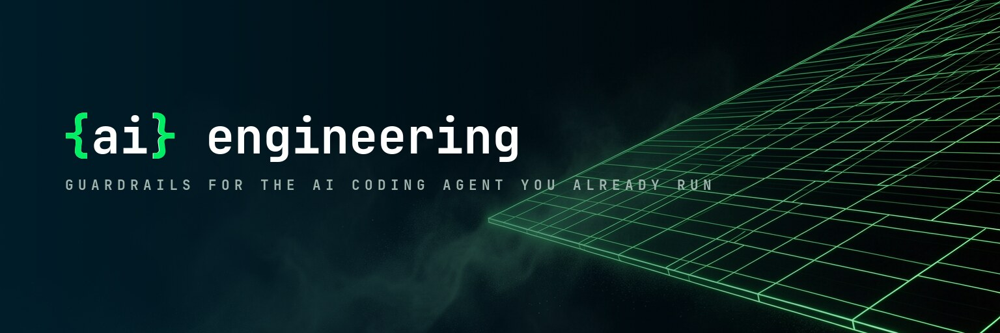
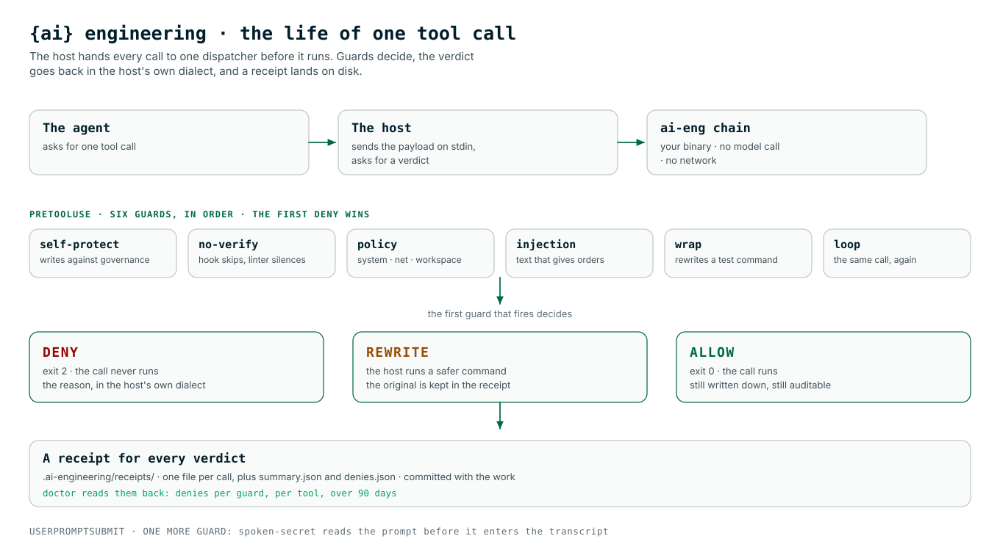
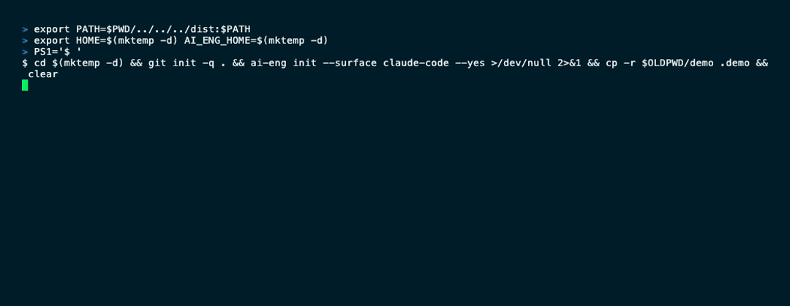
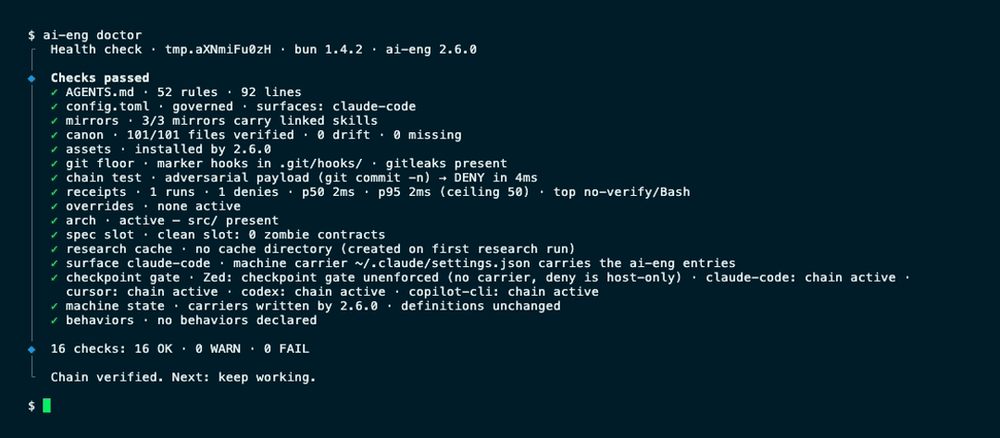

<div align="center">



**Guardrails for AI coding agents: install a contract, deny destructive calls, prove every run.**

<p>A contract the agent cannot execute before you approve it.<br/>
Guards that say <strong>no</strong> before the tool call runs.<br/>
A receipt for every verdict, on disk, in git.</p>

<p>
  <a href="https://www.npmjs.com/package/ai-engineering"><picture><source media="(prefers-color-scheme: dark)" srcset="https://shieldcn.dev/npm/ai-engineering.svg?variant=secondary&amp;font=geist-mono&amp;size=sm&amp;mode=dark"></picture></a>
  <a href="https://github.com/arcasilesgroup/ai-engineering/actions/workflows/check.yml"><picture><source media="(prefers-color-scheme: dark)" srcset="https://shieldcn.dev/github/ci/arcasilesgroup/ai-engineering.svg?workflow=check.yml&amp;branch=main&amp;variant=secondary&amp;font=geist-mono&amp;size=sm&amp;mode=dark"></picture></a>
  <a href="https://sonarcloud.io/project/overview?id=arcasilesgroup_ai-engineering"><picture><source media="(prefers-color-scheme: dark)" srcset="https://shieldcn.dev/sonar/quality-gate/arcasilesgroup_ai-engineering.svg?variant=secondary&amp;font=geist-mono&amp;size=sm&amp;mode=dark"></picture></a>
  <a href="https://sonarcloud.io/component_measures?id=arcasilesgroup_ai-engineering&amp;metric=coverage"><picture><source media="(prefers-color-scheme: dark)" srcset="https://shieldcn.dev/sonar/coverage/arcasilesgroup_ai-engineering.svg?variant=secondary&amp;font=geist-mono&amp;size=sm&amp;mode=dark"></picture></a>
  <a href="https://snyk.io/test/github/arcasilesgroup/ai-engineering"><picture><source media="(prefers-color-scheme: dark)" srcset="https://shieldcn.dev/badge/security-monitored.svg?logo=snyk&amp;variant=secondary&amp;font=geist-mono&amp;size=sm&amp;mode=dark"></picture></a>
</p>

<p>
  <a href="https://ai-engineering.arcasiles.com"><picture><source media="(prefers-color-scheme: dark)" srcset="https://shieldcn.dev/badge/website-ai--engineering.arcasiles.com.svg?variant=secondary&amp;font=geist-mono&amp;size=sm&amp;mode=dark"></picture></a>
  <a href="https://github.com/arcasilesgroup/ai-engineering/releases"><picture><source media="(prefers-color-scheme: dark)" srcset="https://shieldcn.dev/github/release/arcasilesgroup/ai-engineering.svg?variant=secondary&amp;font=geist-mono&amp;size=sm&amp;mode=dark"></picture></a>
  <a href="LICENSE"><picture><source media="(prefers-color-scheme: dark)" srcset="https://shieldcn.dev/github/license/arcasilesgroup/ai-engineering.svg?variant=secondary&amp;font=geist-mono&amp;size=sm&amp;mode=dark"></picture></a>
</p>

| | |
|---|---|
| **7** protection guards | Checks per tool call, before the tool runs |
| **1** prompt guard | `spoken-secret`, on surfaces with a prompt hook |
| **1** output filter | `wrap`, which shortens test output |
| **0** hosted services | No daemon, no control plane |
| **0** model calls | `ai-eng` never calls a model: your key, your model |

</div>

## Contents

- [Why it exists](#why-it-exists)
- [Install](#install)
- [Quick start](#quick-start)
- [How a tool call is decided](#how-a-tool-call-is-decided)
- [Security](#security)
- [Skills and the build loop](#skills-and-the-build-loop)
- [Surfaces](#surfaces)
- [CLI](#cli)
- [Configuration](#configuration)
- [Troubleshooting](#troubleshooting)
- [Development](#development)
- [Maintainers](#maintainers)
- [License](#license)

## Why it exists

Your coding agent can run any command, edit any file and read any page. Nothing stands
between the request and the action: a commit that skips the hooks, a silenced linter, a retry
loop that never ends, a file whose text gives the model orders. By the time you notice, the
damage is in your history.

Your repository already holds the rules against this, written for people: do not skip the
hooks, do not silence the linter, do not edit the config that governs you. An agent follows
them most of the time. A rule that must be remembered on every call is a habit, and habits
lapse.

`ai-eng` turns the rules that never change into code that runs on every call. It runs
locally, under the agent you already use. The host sends each governed tool call to the CLI,
and the CLI answers in that host's own format: **allow**, **deny**, or a rewritten command.
The judgment calls stay with you.

## Install

Install [Bun](https://bun.com) (>= 1.4.4) once, then the CLI, then govern a repository:

```bash
bun add -g ai-engineering@latest    # or: npm install -g ai-engineering@latest
ai-eng init
```

`ai-eng init` asks which agents to govern, installs the skills on your machine, and writes the
contract into the repository you are in. You can run it again at any time; it converges.

The npm package ships the launcher, the source, the skills, the agents and the templates.
Each GitHub release also ships compiled binaries for eight platforms.

### From source

```bash
git clone https://github.com/arcasilesgroup/ai-engineering.git
cd ai-engineering && bun install && bun run build && bun link
```

### Without administrator rights

Nothing `ai-eng` installs or writes needs administrator rights. The binary, the skills, the
hook files and the git hooks all live in your user folder or in the repository.

| Tool | Windows | macOS and Linux |
|---|---|---|
| Bun | `powershell -c "irm bun.sh/install.ps1 \| iex"` | `curl -fsSL https://bun.sh/install \| bash` |
| `ai-eng` | `bun add -g` (into `~/.bun`), or `npm install -g` (into `%APPDATA%\npm`) | `bun add -g` (into `~/.bun`), or run `npm config set prefix ~/.local` before `npm install -g` |
| gitleaks | `winget install --id Gitleaks.Gitleaks -e` | the release binary into `~/.local/bin` |

The commit floor needs gitleaks. Where your company blocks winget, use `curl.exe` and
`tar.exe`, which ship with Windows 10 and 11. In PowerShell, with the version from the
[gitleaks releases page](https://github.com/gitleaks/gitleaks/releases):

```powershell
$v = "8.30.0"; $dir = "$env:LOCALAPPDATA\Programs\gitleaks"
New-Item -ItemType Directory -Force $dir | Out-Null
curl.exe -sSfL -o "$env:TEMP\gitleaks.zip" "https://github.com/gitleaks/gitleaks/releases/download/v$v/gitleaks_${v}_windows_x64.zip"
tar -xf "$env:TEMP\gitleaks.zip" -C $dir gitleaks.exe
[Environment]::SetEnvironmentVariable("Path", [Environment]::GetEnvironmentVariable("Path", "User") + ";$dir", "User")
```

The last line adds the folder to your user `PATH` only. Open a new terminal for it to apply.

## Quick start

<p align="center">
  
  <br/><sub>a real session, sped up: <code>ai-eng init</code>, then <code>ai-eng doctor</code></sub>
</p>

1. **Govern the repository.** Run `ai-eng init` inside it and pick the agents you use. It
   writes `AGENTS.md`, `DECISIONS.md`, `.ai-engineering/config.toml` and the git hooks.
2. **Trust the folder in your agent.** Hooks do not run in an untrusted folder. This is the
   one step `ai-eng` cannot do for you.
3. **Prove the chain answers.** Run `ai-eng doctor`. It sends one real attack payload to the
   chain and reports whether the deny came back.
4. **Work as usual.** Give your agent a task. Every governed tool call passes the chain first.

Optional, once: run `/ai-refresh-project` in your agent. It aligns `AGENTS.md`, the docs, the
layer rules and the config with this repository.

## How a tool call is decided

<p align="center">
  <picture>
    <source media="(prefers-color-scheme: dark)" srcset=".github/assets/guard-flow-dark.svg">
    
  </picture>
</p>

The chain reads the host's payload on stdin and answers in the same format. One set of
definitions serves every agent. Each guard runs only for the tools it governs, in this order,
and the first deny wins:

| Order | Guard | Denies |
|---|---|---|
| 1 | `self-protect` | writes to anything that governs the agent: `.ai-engineering/` (except the milestone files a session owns), the agent settings, the git hooks, the installed skills |
| 2 | `no-verify` | anything that skips the git hooks: `--no-verify`, `git commit -n`, `HUSKY=0`, deleting the hooks folder, repointing `core.hooksPath`. And every comment that silences a linter or a type checker: ESLint, TypeScript, Ruff and Flake8, Bandit, clang-tidy |
| 3 | `no-stash` | creating a stash, which takes work off its branch; `list`, `show`, `apply`, `pop` and `branch` still work |
| 4 | `policy` | commands outside the allowed scope (see [Configuration](#configuration)) |
| 5 | `injection` | reading a file, or acting on a fetched page, whose text carries instructions to the model. The text is data, never an order |
| 6 | `loop` | the same call repeated, or the same failure retried with small changes |
| 7 | `checkpoint` | phase and gate writes that break the active workflow checkpoint. It is the workflow gate, not a protection guard |
| 8 | `lease` | a write in a folder another session wrote in during the last 15 minutes. The second session goes to a worktree; `ai-eng work release` frees the folder |
| 9 | `wrap` | nothing. It rewrites a recognized test command to `ai-eng wrap test -- <command>`, which prints only the failures and a summary |

`spoken-secret` checks each prompt you submit, on agents with a prompt hook. It denies a
prompt that seems to contain a credential, and it never prints the value it found.

### What a denial looks like

<p align="center">
  
  <br/><sub>deny, deny, rewrite, and a receipt for each</sub>
</p>

Each denial says why and what to do instead. These are real verdicts:

| The agent tries | The answer |
|---|---|
| `git commit --no-verify` | *"--no-verify skips the git hooks, the floor every agent and every person in this repository commits through. Whatever the hooks would have said is what needs fixing. Run the command without it."* |
| a silenced linter | *"Silencing a check is skipping a hook."* For a legitimate skip, it points to `.ai-engineering/overrides.toml` |
| an edit to the contract you approved | denied. A person changes it, in a reviewed diff |
| the same call 3 times in a 6-call window | denied by the loop guard |
| reading a file that gives the model orders | denied before the model reads it |

## Security

A guard bypass is a critical bug. Report it through [SECURITY.md](SECURITY.md).

- **Fail closed.** A guard that crashes denies. A guard that cannot decide denies.
- **One written bypass.** An entry in `.ai-engineering/overrides.toml` needs a `reason` and an
  `until` date. `ai-eng doctor` lists every active entry with its time left, and an expired
  entry turns the guard back on. Each override lands in the receipt and in the commit.
- **Local state only.** State is versioned files: `.ai-engineering/`, `AGENTS.md`,
  `DECISIONS.md` and the git hooks in your repository, plus `~/.ai-engineering/` on your
  machine. No prompt and no source leaves it.
- **One optional network read.** Commands you type check the npm registry for a newer version
  at most once every 24 hours. Set `AI_ENG_NO_UPDATE_NOTICES=1` to turn it off. Offline, the
  check stays silent.

### Where the guards stop

The guards stop an agent's mistakes. They are not a sandbox.

The Copilot adapter (CLI and VS Code) shares one harness and one hook file set for both
hosts. Its `preToolUse` command hook **fails closed** on a crash or non-zero exit, but
**fails open** when `ai-eng` is not on `PATH` (the template exits 0 on purpose, so a
machine without it is not locked out) and on a timeout. The prompt hook is advisory on
Copilot: `userPromptSubmitted` command output is ignored.

The Antigravity CLI (agy) is declared and **advisory**, and it cannot be enabled:
`ai-eng init --surface agy` and `ai-eng config --add agy` are refused, because no hook of
ours judges an agy call yet. Its hook file ships as a template inside the binary and no
command writes it — only a hand-edited `[surfaces] enabled = ["agy"]` followed by `ai-eng
update` does. That template is guarded per OS: because agy denies on any non-zero exit,
every line first checks for `ai-eng` and, when the app the editor was launched from cannot
resolve it, writes one line to stderr and allows the call — a hook that cannot judge must
not lock a person out of their editor, and stdout stays empty because that is where agy
reads its decision. The [capability matrix](docs/surface-capability-matrix.md) records why
that trade is honest and what would make the surface enforceable.

Command guards read the visible command text. They do not sandbox opaque programs or scripts
prepared in earlier calls: a script written in one call and run in a later call does
whatever it contains.

For untrusted code, use OS-level isolation: a container, a VM or an OS sandbox.

## Skills and the build loop

`ai-eng init` and `ai-eng update` install every skill from `skills/`, with its resources.
They write the skill files and never run them. Attribution for upstream skills travels with
them: [NOTICE.md](NOTICE.md) and [THIRD-PARTY-NOTICES.md](THIRD-PARTY-NOTICES.md).

<p align="center">
  <picture>
    <source media="(prefers-color-scheme: dark)" srcset=".github/assets/skill-chain-dark.svg">
    
  </picture>
</p>

One skill is the build loop: `ai-orchestrator`. Give it a feature. It splits the work into
checkpoints, smallest first, and builds each one through its gates. A checkpoint that fails a
gate does not move on. The loop stops for you twice: to approve the plan, and to review the
app.

- **Before the loop (optional):** `ai-brainstorm` pins the idea in plain words,
  `ai-research` brings evidence, `ai-architect` sets the layer rules.
- **After the loop (optional):** `ai-verify` gives a verdict, `ai-security` an audit,
  `ai-write` the updated docs.
- **Any time:** every other skill, on demand. None adds a required step.

Five triggers send work to the skill that declares them. A **path** trigger reads the diff. A
**judgment** trigger cannot be read from a diff, so the loop asks you once.

| Trigger | Kind | Skill | Fires when |
|---|---|---|---|
| `ui` | path | `ai-audit-design` | the diff touches TSX, JSX, CSS, SCSS, SASS, LESS, Vue, Svelte, components or the Tailwind config, outside `docs/` and `.ai-engineering/` |
| `security` | path | `ai-security` | the diff touches auth, sessions, crypto, secrets, SQL, migrations, dependency manifests, `.github/workflows/`, `src/chain/` or `src/guards/` |
| `open-questions` | judgment | `ai-research` | the brainstorm has open questions, or the plan cites an external API or version |
| `arch-change` | judgment | `ai-architect` | the work adds a subsystem, or changes a layer contract or a dependency direction |
| `public-interface` | judgment | `ai-write` | the diff changes a public interface, a documented behavior or a command shown in this README |

<details>
<summary><b>All 27 skills</b></summary>

| Skill | What it does |
|---|---|
| `ai-adversarial-loop` | Debates a critic and a fixer, round after round, until the code is clean. The review gate of the loop |
| `ai-architect` | Advises on approach, stack, cost and prior art before the build starts |
| `ai-audit-code` | Finds the simplest solution that works: least code, fewest dependencies |
| `ai-audit-design` | Finds and fixes visual defects in a rendered page, by measurement |
| `ai-audit-docs` | Checks the docs against the repository: dead links, false claims, stale versions |
| `ai-brainstorm` | Questions a fuzzy idea until it fits in plain words, then asks for approval |
| `ai-codegraph` | Maps call chains, blast radius and cross-file links |
| `ai-debug` | Names the root cause at `file:line` and writes the failing check before the fix |
| `ai-design-md-planner` | Writes a `DESIGN.md` design system and lints it with the official CLI |
| `ai-explore` | Answers "where does this live", with `file:line` evidence |
| `ai-issue-report` | Drafts a bug report locally, with sensitive fields removed; sends nothing without your yes |
| `ai-note` | Saves a hard-won finding as committed Markdown, stamped so staleness shows |
| `ai-orchestrator` | Builds a feature end to end in gated checkpoints |
| `ai-pr` | Runs the pull request: cut, push, open, watch CI, merge. Your words decide how far it goes |
| `ai-prototype` | Builds a clickable single-file HTML prototype of a screen or flow |
| `ai-read-docs` | Reads the current docs before you depend on external or versioned behavior |
| `ai-refresh-project` | Aligns `AGENTS.md`, the docs, the governance files and the branches with the tree |
| `ai-research` | Answers from outside the repository with numbered sources, or marks a claim `[unsourced]` |
| `ai-review-ui` | Screenshots the live UI and its prototype, then compares them |
| `ai-security` | Runs a six-phase security audit; the finder never verifies its own findings |
| `ai-stress-test` | Finds the load that breaks the system |
| `ai-test-planner` | Plans and writes tests from the bottom layer up |
| `ai-triage` | Ranks one GitHub or Azure DevOps backlog in a read-only report |
| `ai-verify` | Checks finished work at the right depth and returns a verdict with evidence. Its lanes are in `skills/ai-verify/lanes/` |
| `ai-visual-recap` | Turns a diff into an interactive recap: diagrams, file map, annotated diff |
| `ai-write` | Writes a README, wiki page or API doc, verified against the tree |
| `ai-writing-behavior` | Writes `BEHAVIOR.md` specs for agent conduct that can be judged |

</details>

## Surfaces

A surface is an agent host: an IDE or a CLI. `ai-eng` writes one set of definitions and
mirrors it into every surface you enable, so the same guard judges the same call whichever
host sent it. [`src/surfaces/surfaces.json`](src/surfaces/surfaces.json) records what each
host supports.

| Tier | Meaning | Surfaces |
|---|---|---|
| core | deny, plus a rewritten command where the host allows it | `claude-code`, `oh-my-pi`, `opencode`, `cursor`, `pi` |
| experimental | works, less proven | `codex` |
| best-effort | the host limits the outcome | `copilot-cli` |
| skills-only | skills, no interception | `zed`, `agy` |

`ai-eng config --add <id>` and `ai-eng config --remove <id>` turn a surface on or off and
regenerate its files (`agy` and `zed` are declared but refused: see the matrix). `ai-eng doctor` reports, per surface, whether its hook file is where
that host reads it, and whether the surface is **enforced** (synchronous pre-tool deny) or
**advisory** (observation only). The [capability matrix](docs/surface-capability-matrix.md)
is the measured truth for what each host can and cannot enforce; [Global
carriers](docs/global-carriers.md) explains how the carrier files are installed and removed.

## CLI

Six commands for people:

```bash
ai-eng init        # install the contract here (--global: this machine only)
ai-eng doctor      # run every check, plus one real attack payload
ai-eng config      # change the surfaces or the CI provider
ai-eng update      # install a newer version if you agree, then sync this repo
ai-eng work        # list the lanes; tidy, park or drop one
ai-eng uninstall   # remove everything it installed, keep your files
```

<p align="center">
  
</p>

Four commands for hooks, CI and agents:

```bash
echo "$PAYLOAD" | ai-eng chain PreToolUse   # judge one tool call: JSON in, JSON out
ai-eng git pre-commit                       # the pre-commit, commit-msg and pre-push checks
ai-eng wrap test -- <command>               # run tests, print only the failures
ai-eng worktree new <branch>                # start a lane checkout (also: list, merge, rm, request-changes)
```

### Lanes

One task is one lane: a branch, its folder and its pull request. `ai-eng work` lists every
lane from git and the forge. A lane leaves in one of three ways:

- `ai-eng work tidy` closes a landed lane.
- `ai-eng work park <branch> "<reason>"` pauses one, with the reason.
- `ai-eng work drop <branch>` drops one, keeping its commits in `refs/archive/`.

`ai-eng worktree new <branch>` starts from your current `HEAD` and refuses a fourth active
lane. Worktrees live beside the repository in `<repo>.worktrees`, or under `[git]
worktrees_dir`. `ai-eng worktree merge <slug>` merges a reviewed feature locally and keeps
its folder until `ai-eng worktree rm <slug>`. None of these commands pushes. The contributor
workflow is in [CONTRIBUTING.md](CONTRIBUTING.md).

## Configuration

`ai-eng init` writes `.ai-engineering/config.toml` with each key commented and set to its
default. You edit it by hand; the chain reads it and never writes it.

| Table | What it sets |
|---|---|
| `[surfaces]` | the agents this repository is governed on (`ai-eng config` rewrites only this key) |
| `[ci]` | the CI provider |
| `[guards]` | the loop thresholds, the command-scope policy and your own injection rules |
| `[gc]` | what `ai-eng doctor --gc` keeps, and how long receipts live |
| `[git]`, `[work]`, `[notices]` | commented out: worktree folder, lane limits, update notice |

The **command-scope policy** is four octal digits: system, external, network and workspace.
Each digit adds read (4), write (2) and execute (1). The default, `4667`, allows system
reads, external and network reads and writes, and everything in the workspace.

A change an agent proposes to these files is applied by a person, outside the agent session:
`self-protect` denies the agent's own write.

## Troubleshooting

| Symptom | Cause | Fix |
|---|---|---|
| Hooks do not fire | The folder is not trusted in your agent | Trust it, then check the `chain test` line of `ai-eng doctor` |
| A legitimate command was denied | No guard can tell your intent | Add an entry to `.ai-engineering/overrides.toml` with a `reason` and an `until` date |
| `ai-eng: bun not found` | The launcher runs the source under Bun | Install Bun (>= 1.4.4) |
| `ai-eng.ps1 cannot be loaded` on Windows | npm wrote the `.ps1` again, and PowerShell's default policy refuses it | Run `ai-eng.cmd update` once: it removes that file |
| `ai-eng doctor` reports canon drift | The installed skills differ from this version's | Run `ai-eng update` |
| You want no update notice | The notice is on by default | Set `AI_ENG_NO_UPDATE_NOTICES=1` |
| You want it gone | | Run `ai-eng uninstall`: it removes what it wrote and keeps your contract files |

## Development

```bash
bun install
bun run build                  # compile the binary, skills, agents and templates inside
bun test                       # unit, adversarial, gate and architecture tests
bun run lint && bun run typecheck
bun scripts/readme-diagrams.ts # regenerate .github/assets/*.svg
```

- `skills/`, `agents/` and `templates/` are embedded as they are: nothing to regenerate after
  an edit.
- `bun scripts/brand.ts gen` generates `src/theme.ts` and the website tokens
  ([brand/README.md](brand/README.md)).
- The README recordings use [VHS](https://github.com/charmbracelet/vhs): run
  `vhs quickstart.tape` or `vhs chain.tape` in `.github/assets/tapes/`.

**Releases.** Versions come from [changesets](.changeset/README.md). A dispatched workflow
publishes to one of two channels, `integration` (npm `next`) or `production` (npm `latest`),
with the compiled binaries, the SBOM and the attestations. `scripts/release-policy.ts`
refuses to publish unless three things hold: a signed annotated tag from an allowed key, on
exactly the dispatched commit, and every row of [NOTICE.md](NOTICE.md) marked `verified`.

The early design document ([docs/history/blueprint.html](docs/history/blueprint.html)) and
[the recap](docs/history/recap.html) are history. This README and the source are current.

## Maintainers

[Arcasiles Group](https://github.com/arcasilesgroup). Read [CONTRIBUTING.md](CONTRIBUTING.md)
and the [Code of Conduct](CODE_OF_CONDUCT.md) before you open a pull request.

<p align="center">
  <a href="https://github.com/arcasilesgroup/ai-engineering/graphs/contributors"></a>
</p>

<p align="center">
  <a href="https://www.star-history.com/#arcasilesgroup/ai-engineering&amp;Date"></a>
</p>

## License

[Apache-2.0](LICENSE) © Arcasiles Group. Third-party attribution is in [NOTICE.md](NOTICE.md)
and [THIRD-PARTY-NOTICES.md](THIRD-PARTY-NOTICES.md).
